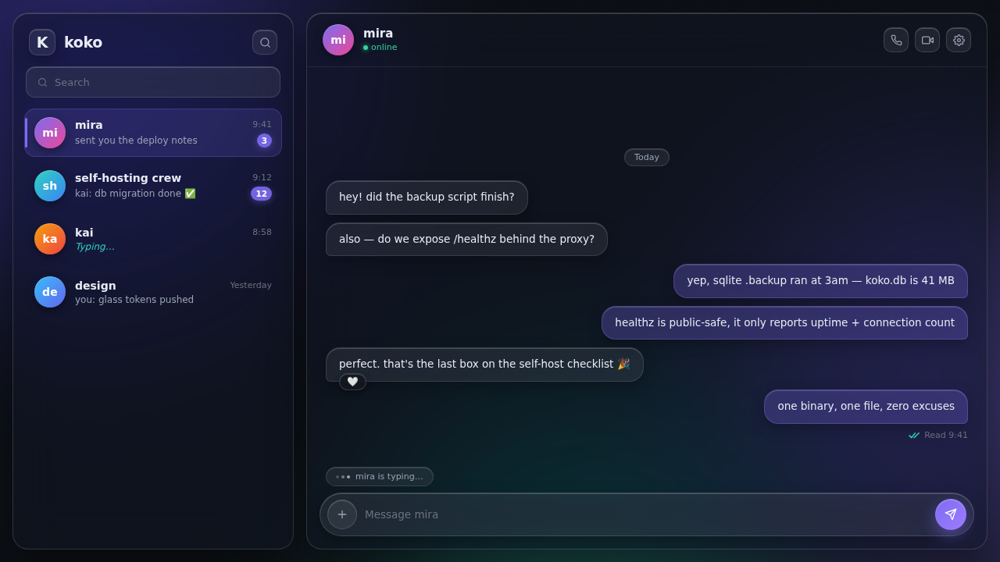
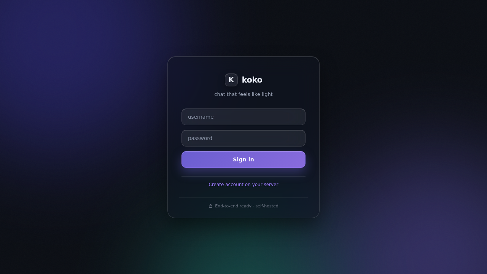
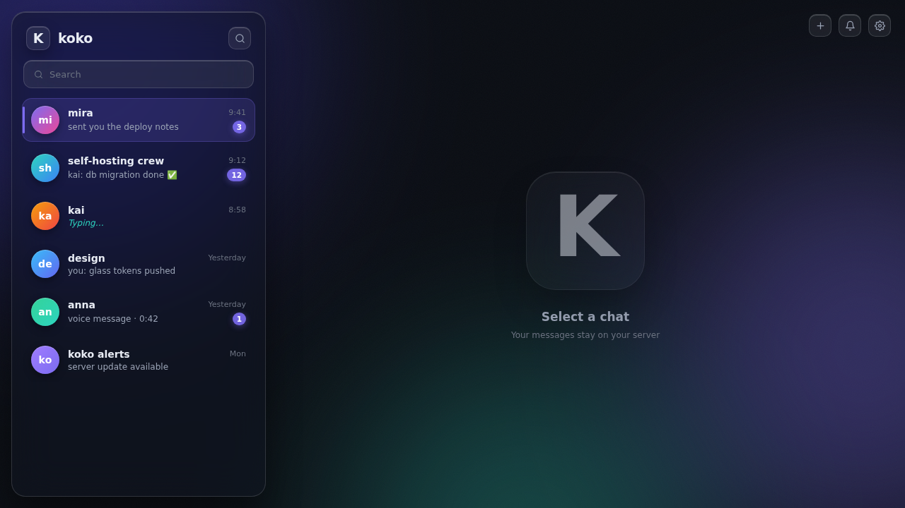
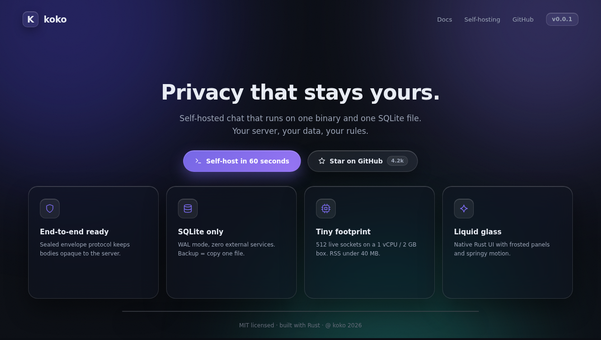
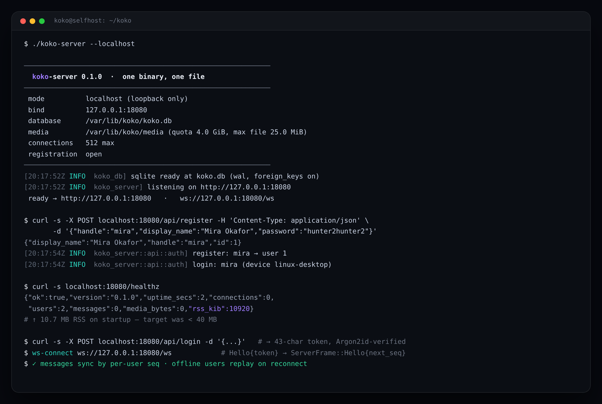
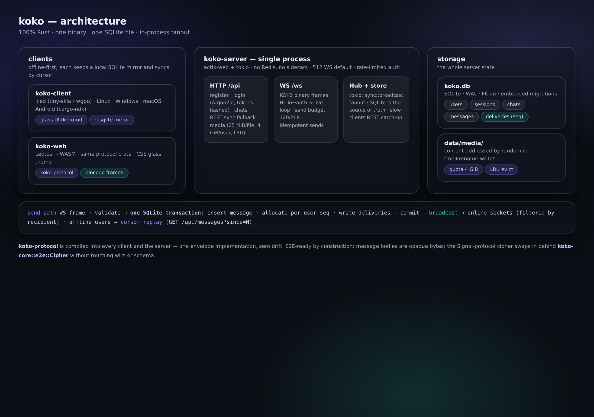

# koko

[](https://github.com/74mdi/salam/actions/workflows/ci.yml)
[](https://github.com/74mdi/salam/actions/workflows/release.yml)
[](https://github.com/74mdi/salam/actions/workflows/docker.yml)
[](LICENSE)

A self-hosted chat app that is **100% native Rust** — no Electron, no app
webviews, no slop. One server binary, one SQLite file, zero external
services. Liquid-glass UI on a dark theme.

**This drop (v0.0.1)** is the working vertical slice: the full wire
protocol, a deployable server with auth + sync + groups + media, a native
iced client, a Leptos/WASM web client, CI/CD for GitHub Actions, and the
self-hosting runbook. See the honest [status matrix](#status) for what is
done and what is next.

<p align="center">
  
</p>

## Screenshots

| | |
|---|---|
|  |  |
| Login — glass card over the aurora wallpaper | Chat list — frosted sidebar, unread badges |
|  |  |
| koko-site landing page (static Next.js) | The real server: register, login, healthz |
|  | |
| The whole system on one page | |

## Status

| Area | State | Notes |
|---|---|---|
| Wire protocol (`koko-protocol`) | **done, tested** | bincode frames, envelopes, versioned magic, 7 roundtrip suites |
| Server (`koko-server`) | **done, tested** | register/login, WS messaging, per-user seq sync, groups, media + LRU quota, rate limits, `--localhost` mode |
| Persistence (`koko-db`) | **done, tested** | SQLite WAL, embedded migrations, single-file fanout transaction |
| Native client (`koko-client`) | **works** | login, chat list, conversation, offline mirror, reconnecting WS, width-adaptive mobile layout; Android cross-compile check (APK/AAB packaging remains TODO) |
| Web client (`koko-web`) | **works** | Leptos → WASM, same protocol crate, glass CSS; `trunk build` |
| Landing page (`koko-site`) | **done** | Next.js static export |
| CI/CD (GitHub Actions) | **done** | fmt/clippy/tests, client, wasm, android check, site, audit, smoke, releases, Docker, deploy |
| E2E encryption | **wire-ready, crypto TODO** | bodies are opaque bytes end-to-end; the demo sends clear text — see [docs/SECURITY.md](docs/SECURITY.md) |
| Calls, voice notes | roadmap | Opus/WebRTC-signaling shapes reserved in the protocol |
| 1 vCPU load test | **partial** | server boots at ~10.7 MB RSS (target < 40 MB); full 512-socket soak test is tracked |

## Hard constraints → how they are met

| Constraint | Implementation |
|---|---|
| 1 vCPU / 2 GB RAM / 5 GB disk | SQLite (WAL, `busy_timeout`), actix-web, in-process fanout; measured startup RSS ~10.7 MB |
| No Redis / Postgres / extra processes | One binary; realtime fanout is `tokio::sync::broadcast` in-process (`hub.rs`) |
| SQLite is the only database | `koko.db` single file, embedded migrations, `PRAGMA foreign_keys=ON` |
| Media: 4 GiB quota, 25 MiB/file | Enforced per upload; LRU eviction frees space automatically |
| 512 concurrent WS (default) | `--max-connections`, enforced before the upgrade, counted per socket |
| Usernames only, `^[a-z][a-z0-9_]{2,23}$` | Validated in `koko-core`, unique index in SQLite (case-insensitive) |
| `koko-server --localhost` | Binds 127.0.0.1 only, opens registration; everything else identical |

## Quickstart (60 seconds)

```bash
git clone https://github.com/74mdi/salam && cd salam

# the server — one process, one file
cargo run -p koko-server -- --localhost

# in another terminal: the native client
cargo run -p koko-client      # server: http://127.0.0.1:8080, make an account, chat
```

Docker people: see [docs/SELFHOSTING.md](docs/SELFHOSTING.md) —
`docker compose up -d` and you are running.

## Workspace

| Crate | Role |
|---|---|
| `koko-protocol` | The wire contract: IDs, envelopes, WS frames, binary codec. Linked by server + both clients — one implementation, zero drift |
| `koko-core` | Domain core: handles, Argon2id, tokens, the E2E `Cipher` seam |
| `koko-db` | SQLite persistence: migrations, repos, the fanout transaction |
| `koko-server` | The binary you deploy: HTTP API + WS + hub + rate limits + media |
| `koko-ui` | Glass design system (tokens + surfaces) for iced |
| `koko-client` | Native client (iced; tiny-skia everywhere, `wgpu` feature for GPU) |
| `koko-web` | Browser client: Leptos → WASM, reuses `koko-protocol` |
| `koko-site` | Static Next.js landing page — never part of the chat path |

Default `cargo build`/`cargo test` covers the server stack (fast, no GUI
toolchain). Build everything with `cargo build --workspace`.

## Documentation

- [docs/SELFHOSTING.md](docs/SELFHOSTING.md) — run it on your own box (Docker, systemd, Caddy/nginx, backups, upgrades)
- [docs/ARCHITECTURE.md](docs/ARCHITECTURE.md) — crates, message pipeline, sync model
- [docs/PROTOCOL.md](docs/PROTOCOL.md) — the wire format, frame by frame
- [docs/SECURITY.md](docs/SECURITY.md) — threat model, Argon2id tradeoff, E2E status (honest)
- [docs/CI.md](docs/CI.md) — GitHub Actions: releases, Docker, one-click deploy

## Quality gates (all enforced in CI)

- `cargo fmt --check` and `cargo clippy -D warnings` — clean
- 34 tests: protocol roundtrips, db fanout/idempotency/LRU, 8 end-to-end
  integration tests driving a real server with real WS clients
- `cargo audit` + `cargo deny` (licenses pinned in `deny.toml`)
- `unsafe` is forbidden workspace-wide; the single future exception (signal
  FFI in `koko-core`) is documented in `koko-core/src/lib.rs`

## License

MIT — see [LICENSE](LICENSE).
