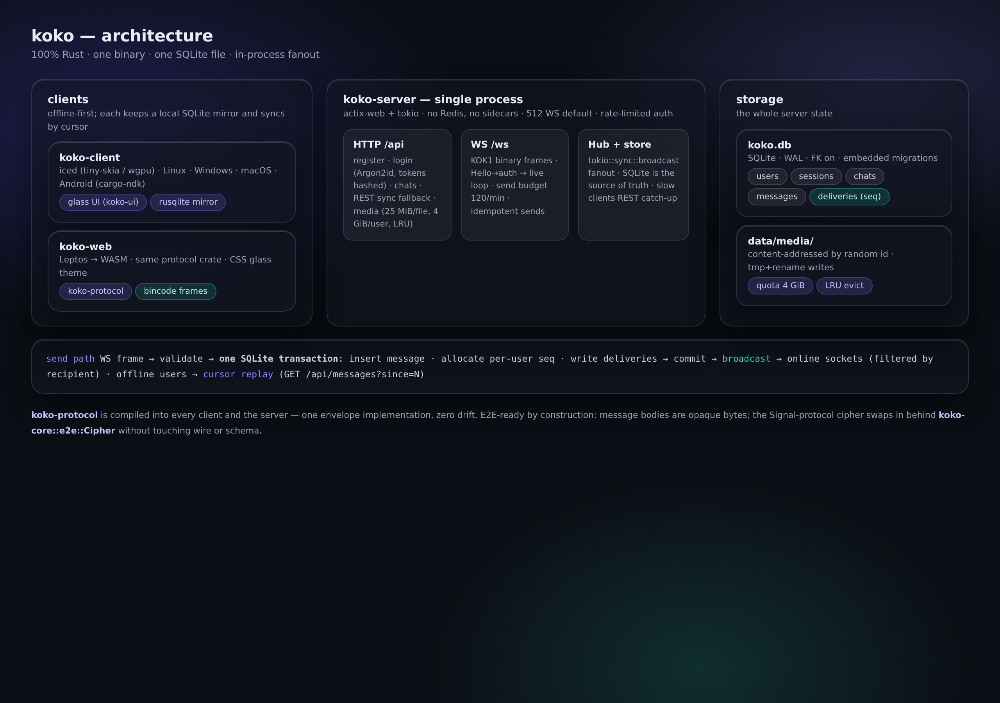

# Architecture

koko is a workspace of seven crates that compile to three deployables
(server, native client, web client) plus a static site. The rule that keeps
it honest: **one protocol crate, linked everywhere** — clients and server
physically cannot drift apart on the wire.

## Crates

| Crate | Depends on | Role |
|---|---|---|
| `koko-protocol` | serde, bincode | Typed IDs, `Envelope`, `ClientFrame`/`ServerFrame`, the `KOK1` codec |
| `koko-core` | protocol, argon2, rand, sha2 | Handles, passwords, tokens, time, the E2E `Cipher` trait |
| `koko-db` | sqlx (sqlite) | Schema, migrations, repos, the fanout transaction |
| `koko-server` | all of the above + actix-web | The deployable binary |
| `koko-ui` | iced | Design tokens + glass surfaces (theme functions) |
| `koko-client` | protocol/core/ui + iced, rusqlite, tokio-tungstenite | Native app with a local mirror |
| `koko-web` | protocol/core + leptos, web-sys | WASM app |
| `koko-site` | next | Static landing page — never in the chat path |

Unsafe policy: `#![forbid(unsafe_code)]` workspace-wide (root
`Cargo.toml`). The one carved-out future exception — `libsignal` FFI in
`koko-core` — is documented in that crate and does not exist yet.

## The message pipeline

Everything a message needs to be correct happens in **one SQLite
transaction** (`koko-db/src/messages.rs::insert_message`):

1. Membership check (sender must belong to the chat).
2. Idempotency probe on `(chat_id, sender_id, client_msg_id)`.
3. `INSERT INTO messages` (body opaque, stored as BLOB).
4. For every chat member: bump `inbox_counters.next_seq` and write a
   `deliveries (user_id, seq, message_id)` row.

SQLite's single-writer model is the serialization point: two concurrent
sends can never observe the same `(user_id, seq)`. This is why the sync
protocol can be a single number.

After commit:

- **Online members:** the server publishes one `HubEvent::Message` per
  recipient onto a `tokio::sync::broadcast` channel (capacity 2048). Each
  WS session filters events by its own user id.
- **Offline members:** nothing happens — their rows are already durable.
  On reconnect they say `resume_from: N` (WS backlog, capped at 256) or
  `GET /api/messages?since=N` (REST, authoritative).
- **The sender:** gets `ServerFrame::Sent { client_msg_id, seq }` as the
  durable-ack, and (as a member) also receives its own envelope on other
  sockets.

If a session falls behind the broadcast ring, it gets `RecvError::Lagged`
and is told to REST catch-up — slow clients can never stall writes.

## The sync model

- Every user has a **global, gapless, per-user inbox sequence**.
- A client's entire sync state is one cursor: "I have everything ≤ N".
- Delivery is at-least-once; clients dedupe on `(chat_id, seq)` — the
  client mirror literally uses it as the primary key.
- Gap seen → REST catch-up. There is no vclock, no vector clock, no CRDT:
  the server is the only seq allocator, so none is needed.

## Auth

- Passwords: Argon2id `m=32 MiB, t=2, p=1` — deliberately tuned down for
  the 2 GB box; the full tradeoff lives in
  [SECURITY.md](SECURITY.md#password-hashing) and in the source comments.
- Sessions: 32 random bytes, base64url on the wire, **SHA-256 at rest**,
  device-bound, expiring (30 d default), revocable per-device and
  "logout everywhere".
- Login for unknown users burns a dummy Argon2 verification so the
  "no such user" and "wrong password" timings match.

## Media

`POST /api/media` (raw body, `?name=` for the original filename):

1. Per-file cap 25 MiB → 413.
2. Per-user quota 4 GiB → LRU eviction: least-recently-*downloaded* rows
   are deleted (metadata transactionally, files unlinked) until the
   upload fits. Still doesn't fit → 413.
3. Writes go to `<id>.part` then rename — nobody ever reads a half-written
   blob. A failed metadata insert removes the file; a failed file write
   never inserts metadata. No orphans, no dangling rows.

`GET /api/media/{id}` requires a session and bumps the LRU clock
(millisecond resolution).

## Rate limiting

Fixed-window, in-memory, per key (`koko-server/src/limits.rs`):
5 register/hour/IP · 10 login/min/IP · 5 login/min/handle · 60
upload/min/user · 120 send/min/socket. A std `Mutex` over a `HashMap` —
nanosecond critical sections, no Redis, reset on restart (documented,
accepted).

## The clients

**Native (`koko-client`)** — offline-first: every envelope lands in a
local SQLite mirror before it renders; views read the mirror; sends are
optimistic echoes flipped to delivered by the `Sent` ack. The WS connector
is one subscription task that reconnects with backoff; while offline,
outgoing sends queue in an unbounded channel and flush on reconnect.

The same views switch to a touch-friendly, single-panel layout below 760
logical pixels and by default on Android. Chat list, conversation, profile,
appearance, account, and AI settings stay available in that layout. Android
APK/AAB packaging is still a separate roadmap item; CI currently cross-checks
the Rust client for `aarch64-linux-android`.

Rendering: iced on `tiny-skia` by default (runs on any Linux, no GPU), the
`wgpu` feature upgrades to the GPU renderer. `koko-ui` approximates the
liquid-glass language with layered translucency, specular borders and deep
shadows on every backend; the true backdrop-blur shader pass (iced_glass
style) is the planned upgrade behind the same tokens.

**Web (`koko-web`)** — same protocol crate compiled to WASM, Leptos CSR,
glass via CSS `backdrop-filter` (browsers do real blur natively).

## E2E readiness (honest)

The wire and storage treat `envelope.body` as opaque bytes today. The demo
client sends clear text, so v0.1 is transport-secured, not
end-to-end-encrypted. The swap point is `koko_core::e2e::Cipher` —
`NoopCipher` (current) → `SignalCipher` (X3DH + Double Ratchet, sender
keys for groups) without touching the protocol or the schema. Details and
threat model: [SECURITY.md](SECURITY.md).

## Roadmap

1. `SignalCipher` + key-bundle routes (E2E milestone)
2. Glass shader pass on wgpu; spring-physics motion
3. Voice notes (Opus) + blurhash placeholders
4. Calls: WebRTC with koko as signaling-only
5. Packaging: AppImage/flatpak/deb, Android AAB via cargo-ndk
6. Load-test proof at 512 sockets / 50 msg/s on 1 vCPU
