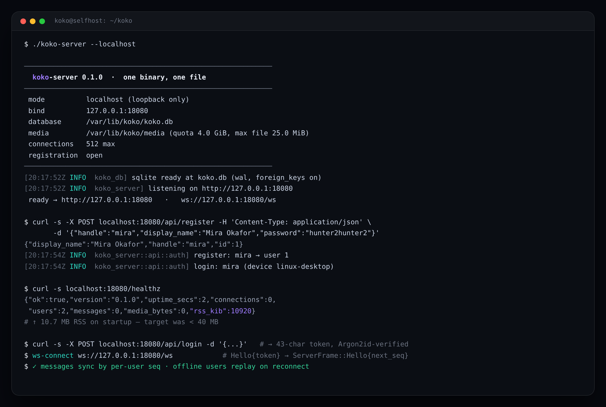

# Self-hosting koko

You can run your own chat server on anything from a laptop to a $4 VPS.
The whole server is **one binary + one SQLite file + one media folder** —
no Redis, no Postgres, no message queues, no sidecars.

Requirements: Linux/macOS/Windows, ~40 MB RAM free, 1 GB disk.
A 1 vCPU / 2 GB box is the officially supported floor.

The live server, doing its job (real output, release build):



## Contents

- [Pick your path](#pick-your-path)
- [Path A — localhost mode (try it now)](#path-a--localhost-mode-try-it-now)
- [Path B — Docker on a VPS](#path-b--docker-on-a-vps)
- [Path C — bare binary + systemd](#path-c--bare-binary--systemd)
- [TLS with Caddy or nginx](#tls-with-caddy-or-nginx)
- [Creating the first account](#creating-the-first-account)
- [Configuration reference](#configuration-reference)
- [Connecting clients](#connecting-clients)
- [Backups and restore](#backups-and-restore)
- [Upgrades](#upgrades)
- [Monitoring](#monitoring)
- [Troubleshooting](#troubleshooting)

## Pick your path

| You want | Path |
|---|---|
| Try koko on your own machine right now | [A — localhost](#path-a--localhost-mode-try-it-now) |
| A small VPS, containers, one-click deploys from GitHub Actions | [B — Docker](#path-b--docker-on-a-vps) |
| A lean VM without Docker | [C — systemd](#path-c--bare-binary--systemd) |

## Path A — localhost mode (try it now)

```bash
cargo run -p koko-server -- --localhost
```

That binds **127.0.0.1 only** and opens registration (so you can make an
account from the client). Everything else — database, media, limits — is
identical to server mode.

Then start a client:

```bash
cargo run -p koko-client                     # native (iced)
(cd koko-site && npm ci && npm run dev)      # browser (Next.js at localhost:3000)
```

State lands in `./koko.db` and `./data/media/`. Delete them to reset.

## Path B — Docker on a VPS

The image is `ghcr.io/koko-chat/koko` (built by the `docker` workflow on
every push to `main` and every tag).

```bash
mkdir -p /opt/koko && cd /opt/koko
wget https://raw.githubusercontent.com/74mdi/salam/main/docker-compose.yml
docker compose up -d

curl http://127.0.0.1:8080/healthz
```

All state lives in `/opt/koko/data` (the SQLite file + media). Registration
is **closed** by default in this path — see
[creating the first account](#creating-the-first-account).

To deploy new versions automatically, use the `deploy` workflow
([docs/CI.md](CI.md#one-click-deploy)): it SSHes in, pulls the image, and
restarts the container.

## Path C — bare binary + systemd

Grab a release from the GitHub releases page (or build one):

```bash
# from source
cargo build --release -p koko-server
sudo cp target/release/koko-server /usr/local/bin/
```

Create the service user and state directory:

```bash
sudo useradd --system --home /var/lib/koko koko
sudo mkdir -p /var/lib/koko/media && sudo chown -R koko:koko /var/lib/koko
```

Install the unit (file is in `deploy/systemd/`):

```bash
sudo cp deploy/systemd/koko-server.service /etc/systemd/system/
sudo systemctl daemon-reload
sudo systemctl enable --now koko-server
journalctl -u koko-server -f
```

The unit hardens the process (`NoNewPrivileges`, `ProtectSystem=strict`,
`PrivateTmp`, …) — copy it verbatim, it needs nothing else.

## TLS with Caddy or nginx

koko does not terminate TLS itself — put a proxy in front and keep the
socket upgrade intact. Ready-made configs live in `deploy/`:

- `deploy/caddy/Caddyfile` — automatic HTTPS via Let's Encrypt
- `deploy/nginx/koko.conf` — nginx + certbot

Either way the essentials are:

```nginx
proxy_http_version 1.1;
proxy_set_header Upgrade $http_upgrade;      # WebSocket (/ws)
proxy_set_header Connection "upgrade";
client_max_body_size 30m;                    # media uploads (25 MiB + slack)
proxy_read_timeout 3600s;                    # long-lived sockets
```

## Creating the first account

On a **public bind, registration is closed by default** (`--open-registration`
off). Two safe ways to make the first account:

1. SSH tunnel to localhost mode (recommended):

   ```bash
   # on the server, temporarily:
   koko-server --localhost --bind 127.0.0.1:8080 --db /var/lib/koko/koko.db \
               --media-dir /var/lib/koko/media &
   # on your laptop:
   ssh -L 8080:127.0.0.1:8080 you@server
   # now point the client at http://127.0.0.1:8080 and register
   ```

2. Flip registration on briefly:

   ```bash
   KOKO_OPEN_REGISTRATION=true systemd... # restart, register, flip back
   ```

After the first accounts exist, keep registration closed and invite people
by… running their own server, or opening it when you choose.

## Configuration reference

Every flag has an environment variable twin — the Docker image is
configured purely through env vars.

| Flag | Env var | Default | Meaning |
|---|---|---|---|
| `--localhost` | — | off | Bind 127.0.0.1 only + open registration |
| `--bind ADDR` | `KOKO_BIND` | `0.0.0.0:8080` | Socket address (port honored in localhost mode too) |
| `--db PATH` | `KOKO_DB` | `koko.db` | SQLite file; created + migrated on boot |
| `--media-dir PATH` | `KOKO_MEDIA_DIR` | `data/media` | Media store directory |
| `--media-quota BYTES` | `KOKO_MEDIA_QUOTA` | `4294967296` | Per-user quota (4 GiB) |
| `--max-file-size BYTES` | `KOKO_MAX_FILE_SIZE` | `26214400` | Per-file cap (25 MiB) |
| `--max-connections N` | `KOKO_MAX_CONNECTIONS` | `512` | Concurrent WS sockets |
| `--open-registration` | `KOKO_OPEN_REGISTRATION` | `false` | Allow account creation (implied by `--localhost`) |
| `--token-ttl-days N` | `KOKO_TOKEN_TTL_DAYS` | `30` | Session lifetime |
| `--cors-origins ORIGINS` | `KOKO_CORS_ORIGINS` | GitHub Pages + localhost | Comma-separated browser origins allowed to call the HTTP API |

Fixed policies (source: `koko-server/src/limits.rs`): 5 registrations per
hour per IP; 10 logins/min per IP and 5/min per handle; 60 media
uploads/min per user; 120 sends/min per socket.

## Connecting clients

- **Native:** `cargo run -p koko-client`, type your server URL
  (`https://koko.example.com`), register/sign in. The client keeps a local
  SQLite mirror (`koko-mirror.db`, override with `KOKO_MIRROR`) and syncs
  by cursor — it works offline and catches up on reconnect.
- **Web:** import this repository into Vercel and set the project root
  directory to `koko-site` (the detected framework is Next.js), or use the
  GitHub Pages workflow. The app is a static Next.js export and
  connects from the browser directly to your Koko server; it does not host
  the chat API or database. Open `/web/`, enter your server URL, and sign in.
- **Browser CORS:** allow the exact website origin on the Koko server. For
  Vercel, set `KOKO_CORS_ORIGINS` to a comma-separated list that includes
  your Vercel production domain and any preview domain you use, for example:

  ```sh
  KOKO_CORS_ORIGINS=https://your-project.vercel.app,https://chat.example.com
  ```

  The default includes `https://74mdi.github.io` and local development
  origins. Restart the server after changing the setting. Use HTTPS for both
  the website and public server; browsers block insecure WebSocket/API
  connections from an HTTPS page.

## Backups and restore

The entire server state is two paths. Back them up and you own your chat.

```bash
# consistent SQLite snapshot (safe while running)
sqlite3 /var/lib/koko/koko.db ".backup '/backup/koko-$(date +%F).db'"
# media
rsync -a /var/lib/koko/media/ /backup/media/
```

Restore: stop the server, put both paths back, start it. That's it —
schema migrations run automatically on boot.

## Upgrades

Replace the binary (or `docker compose pull && docker compose up -d`) and
restart. Embedded SQL migrations apply forward-only on boot; there is no
manual migration step. Roll back by restoring the backup.

## Monitoring

`GET /healthz` is public and cheap:

```json
{"ok":true,"version":"0.0.1","uptime_secs":2,"connections":0,
 "max_connections":512,"users":2,"messages":0,"media_bytes":0,"rss_kib":10920}
```

Wire it to uptime monitors (UptimeRobot, healthchecks.io) or Prometheus
blackbox probes. Logs are structured text via `env_logger`
(`RUST_LOG=info` default; `RUST_LOG=debug` for frame-level detail).

## Troubleshooting

| Symptom | Fix |
|---|---|
| Clients can't connect behind the proxy | Proxy must pass `Upgrade`/`Connection` headers (see the TLS section) |
| `429` on register | Rate limit: 5/hour/IP by design; wait or whitelist via proxy |
| `403` on register | Registration is closed — see [first account](#creating-the-first-account) |
| `413` on upload | File > 25 MiB (`--max-file-size`) or quota exhausted (`--media-quota`; LRU frees space per upload) |
| WS drops after ~60s idle | Proxy idle timeout — raise `proxy_read_timeout` |
| Database locked errors | You have two servers on the same `koko.db`; you shouldn't |
| Reset everything | Stop the server, delete `koko.db*` and the media dir |
